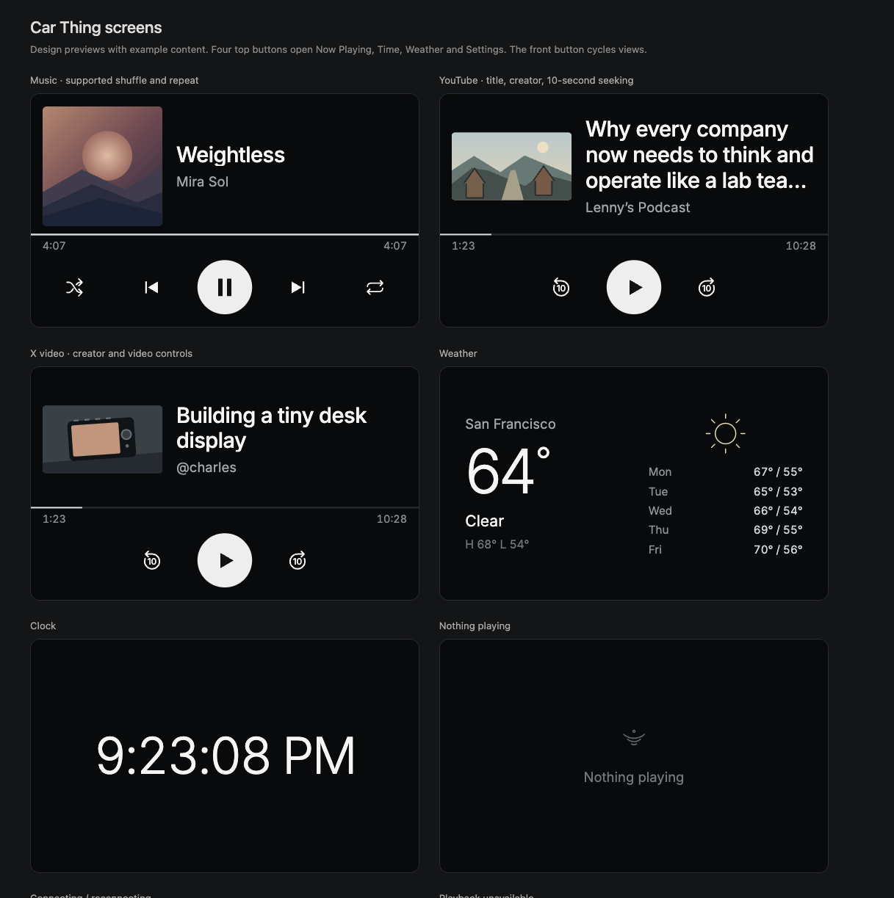

# SideThing


Your Car Thing, your Mac, your own display. Now Playing, time, local weather and brightness—with large touch targets and simple controls.

Plain HTML/CSS/JS on the device. A small Swift menu-bar helper on the Mac. No account, cloud backend, Electron app or Node runtime. SideThing runs independently of DeskThing and Thing Labs applications.



## Install

You need an **Apple Silicon Mac**, [Homebrew](https://brew.sh), Apple command-line tools (`xcode-select --install`), and a **Car Thing with root ADB access and the Chromium/supervisord Linux display stack**. [Supported hardware and recovery](docs/device.md). Stock-device rooting is not included.

Connect one Car Thing by USB:

```sh
git clone https://github.com/charliec2004/sidething.git
cd sidething
./setup.sh
./device/install.sh
```

Setup builds and opens the Mac helper. Allow location access for weather and Music automation for direct playback, shuffle and repeat. Device installation saves verified private backups, installs SideThing’s startup and replaces the old boot screens. Reboot once afterward. Keep the menu-bar helper running; USB reconnects are automatic.

## Set up with an agent

Give your coding agent the GitHub URL and this prompt:

> Set up SideThing from this repository on my Mac and connected Car Thing. Read the README and setup scripts first. Check the prerequisites, then run `./setup.sh` and `./device/install.sh`. Verify the original backup before changing startup or boot artwork. Keep credentials and backups private. If the device is stock or unsupported, stop and explain what is missing. Verify playback, all four pages, audio output, volume, brightness and reconnecting on the actual device. Report what worked and anything that needs my input.

## Controls

Top buttons: **1 Now Playing · 2 Time · 3 Weather · 4 Settings · 5 screen on/off**. The front button cycles pages.

- **Dial:** volume normally, minutes in the timer selector, brightness on Settings.
- **Dial press:** play/pause media; start/pause the timer, or dismiss its Done screen.
- **Clock:** tap anywhere through five clock styles and the timer. Choose minutes with the dial, touch controls or drag. Completion opens a pulsing alert; checkmark dismisses it, replay restarts the same duration.
- **Weather:** tap anywhere to switch between five days and five hours.
- **Playback:** drag the timeline to seek with a large preview above your finger. Video skips ±10 seconds. The artwork arrow cycles supported players; new playback selects the latest player.
- **Audio output:** tap the bottom-right icon to choose speakers or headphones. Volume feedback sits beside the physical dial; Settings also has a brightness slider.

Night Shift follows the Mac’s enabled state and strength with an approximate display tint. Unsupported macOS versions leave the tint off.

[All screens and interaction states](docs/screens.md) · [Optional video bridge](browser-bridge/README.md)

## Updates & development

Use **Check for updates…** in the Mac menu bar, or run `./update.sh`. Updates build the latest GitHub release from this checkout, restart the helper and retain pairing/settings. Keep the source checkout and build tools installed. Restore the device’s original startup with `./device/restore.sh`.

```sh
npm run check  # JS syntax + optimized Swift build
npm test       # isolated fixtures; Node 22+ for development only
```

Internal build and browser installation scripts live in `scripts/`; device installation and recovery live in `device/`.

Edit `public/` for the display and `native/` for the helper. **Preview all screens** opens the interactive gallery. Test at 800×480, narrow widths and on the device. [Architecture and verification](docs/development.md).

[MIT](LICENSE). [Third-party notices](THIRD_PARTY.md). Weather by [Open-Meteo](https://open-meteo.com/) (CC BY 4.0).
