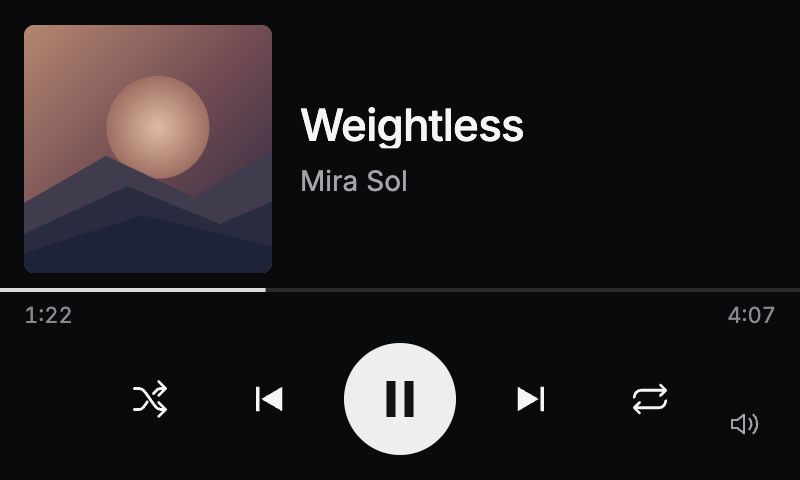
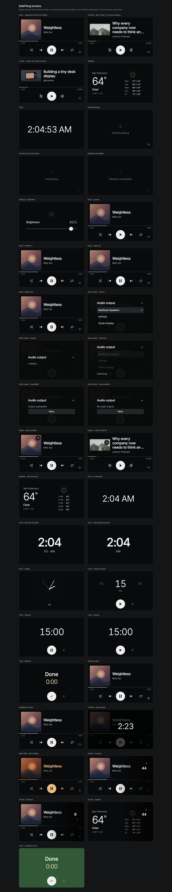
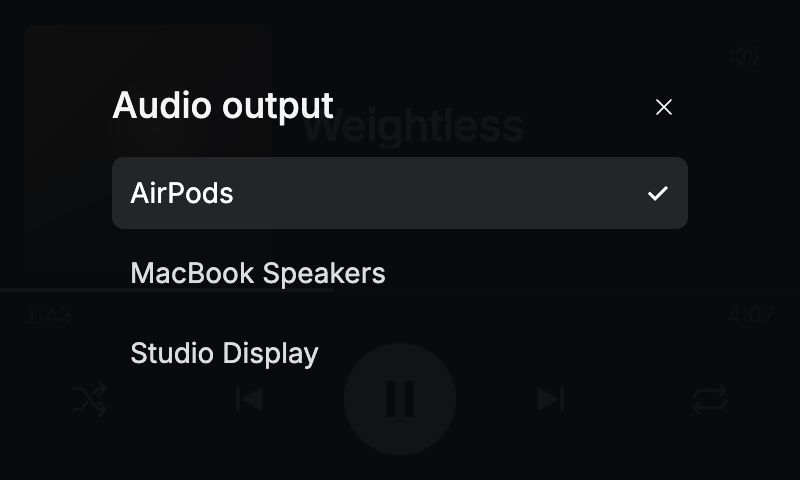
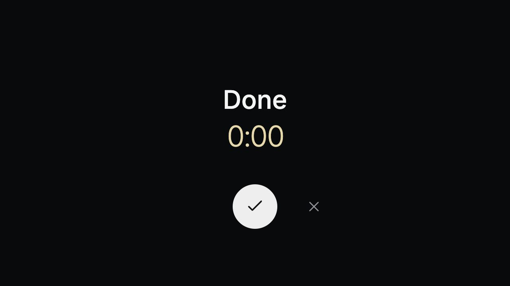
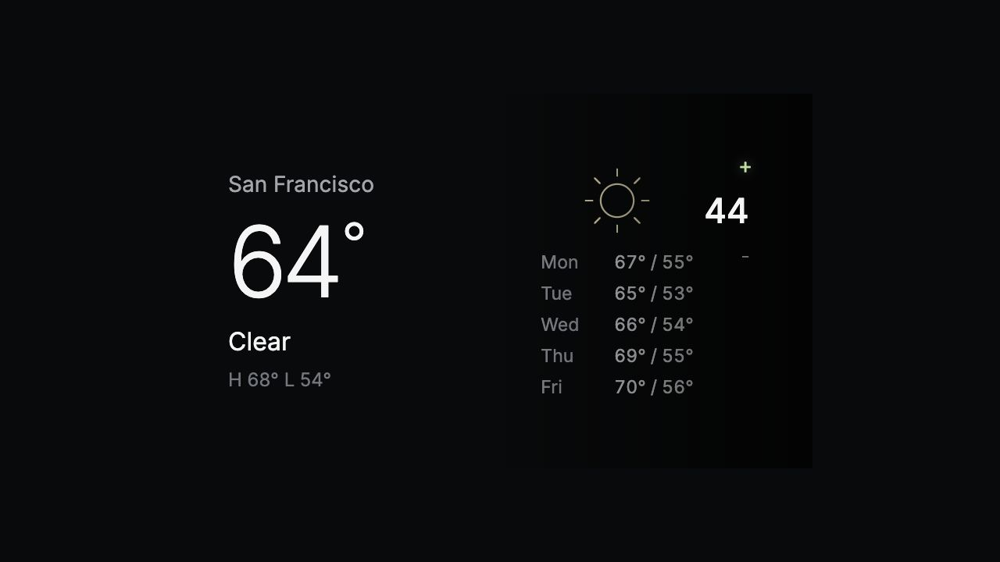

# Screens & states

Open **Preview all screens** from SideThing’s menu bar for the interactive gallery. These are design examples, not a capture of your private playback or location.

The gallery covers music/video, paused playback, shuffle, repeat all/one, clock, local weather, brightness, idle/reconnecting/unavailable playback, and the audio-output picker’s normal/loading/switching/unavailable/empty states.

The small speaker icon sits in the bottom-right corner of Now Playing, clear of the physical dial. Tap it to see the current output and choose another. Names stay in the picker; Now Playing stays minimal.

The interactive gallery also includes player cycling on square/wide artwork, hourly weather, five clock styles, timer setup/running/paused/finished with Done and Replay, AirPods/headphone icons, touch seeking and Night Shift. These use fictional content.

Volume previews show the dial-side number and direction feedback on media and weather. The old toast has a fixed width; `wheelVolume` in `public/app.js` switches the experiment back to it. The upper-right content inset reserves space for the physical dial.

